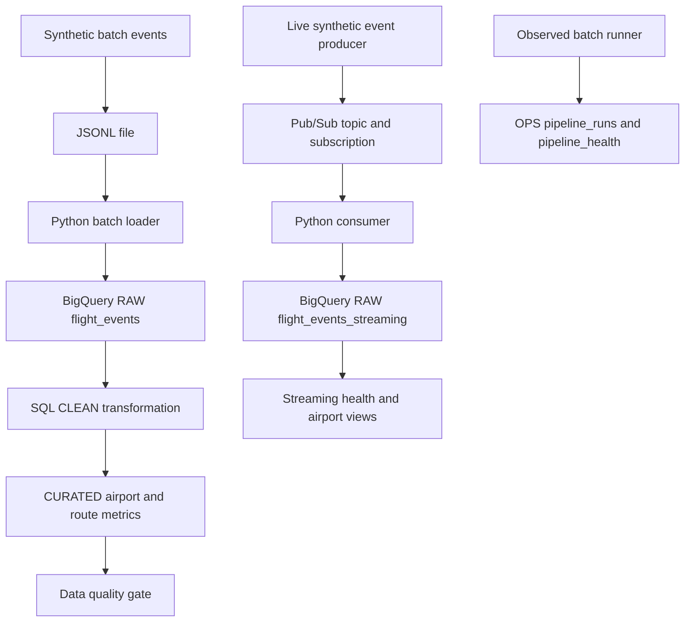

# SkyFlow .::. Airline DataOps Platform

A portfolio project that processes synthetic airline events through batch and streaming pipelines on Google Cloud. Python handles generation, ingestion and operational logging; BigQuery provides RAW, CLEAN, CURATED and monitoring layers; Pub/Sub transports streaming events.

This is an independent learning project using synthetic data. It is not affiliated with any airline or another airline. An AI diagnostic agent and CI/CD are planned, not implemented.

## Architecture



The streaming table feeds operational views; it is not currently merged into the batch CLEAN/CURATED path.

## Implemented and verified

- Batch: generate 1,000 events, load RAW, normalize CLEAN statuses, build CURATED metrics, and enforce ten quality checks.
- Streaming: publish events to Pub/Sub, write them to BigQuery, and acknowledge messages after accepted writes.
- Observability: record batch outcomes, duration, row counts and error messages in BigQuery.
- Terraform: import four existing datasets plus the topic and subscription, with lifecycle deletion guards and a zero-change plan check.
- Tests: 26 offline cases covering generation, quality gates, write failures, acknowledgements, batch logging and streaming exit status.

The existing cloud pipeline was verified during development. Offline tests mock Google clients and do not prove current cloud health or execute the transformation SQL.

## Local setup and tests

Tested locally with Python 3.12.15. From the repository root:

```bash
python3 -m venv .venv
source .venv/bin/activate
python -m pip install -r requirements.txt
python -m pytest -q
```

Expected: `26 passed`. The dependency file records the existing development environment; a clean install in CI is still pending.

## Existing Google Cloud environment

The Python, SQL and scripts currently reference project `skyflow-511113`; BigQuery uses `asia-south1`. Pub/Sub resource names are global. Using another project requires replacing the explicit project references throughout the source and SQL.

Cloud runs require the Google Cloud CLI, BigQuery CLI, Application Default Credentials, enabled BigQuery/Pub/Sub APIs and appropriate access to existing resources. For the current authorized project:

```bash
gcloud auth application-default login
gcloud auth application-default set-quota-project skyflow-511113
gcloud config set project skyflow-511113
```

These commands do not grant access to the project. A cloned repository alone does not provision a complete new environment.

From the project root, with `.venv` active:

```bash
# Rebuild batch data and enforce quality checks.
bash scripts/run_batch_pipeline.sh

# Run batch with an observability record.
python src/monitoring/run_observed_batch.py

# Publish events and check the live streaming path.
bash scripts/verify_streaming_pipeline.sh
```

The batch loader replaces the RAW batch table contents, and the SQL rebuilds CLEAN/CURATED tables. Streaming verification adds events to the streaming table. Cloud runs use billable Google Cloud services.

The observed batch runner requires the existing `skyflow_ops.pipeline_runs` table. Its creation SQL and health views are under `sql/ops/`.

## Terraform adoption

See [Terraform guide](infra/terraform/README.md). The current Mac already has six imported resources and a local state file. To inspect them:

```bash
cd infra/terraform
terraform init -input=false
terraform state list
bash verify-plan.sh
```

The acceptance result is `0 add, 0 change, 0 destroy`. Do not apply unexpected changes.

The existing dataset owner email is supplied by the ignored `terraform.tfvars`. On a deliberate fresh setup, copy `terraform.tfvars.example` to `terraform.tfvars` and enter the actual existing owner. Import into exactly one active state. Keep state securely backed up; it is not stored in Git.

## Repository layout

```text
src/generator/     Synthetic batch event generation
src/ingestion/     Batch BigQuery loader
src/streaming/     Pub/Sub producer and consumers
src/quality/       BigQuery quality gate
src/monitoring/    Batch observability wrapper
sql/              RAW checks, CLEAN/CURATED transforms, OPS views
scripts/          Batch and streaming verification commands
infra/terraform/  Existing-resource adoption and plan validation
tests/            Offline automated tests
docs/             Verification and GitHub preparation notes
```

## Current limitations

- Raw batch status is generated independently of event type; CLEAN derives the normalized status while preserving the source value.
- Streaming validates required keys but does not fully validate every field value before writing.
- Message retries can produce duplicates; event IDs are used as insert IDs but there is no application-level exactly-once guarantee.
- A failed streaming message is NACKed without a configured dead-letter handling workflow in this code.
- `records_processed` records the final RAW row count, not an independently measured per-run count.
- The streaming verification checks total row-count growth, not a unique test-run ID, so concurrent traffic can affect its result.
- Terraform adopts datasets and Pub/Sub resources; individual tables/views and IAM are not independently managed in this step.
- Automated deployment, fresh-environment provisioning and AI diagnostics remain future work.

## Next milestones

1. Review and publish the GitHub repository.
2. Add GitHub Actions for offline tests and configuration checks.
3. Build the AI diagnostic agent.
4. Finish the demo and portfolio documentation.
