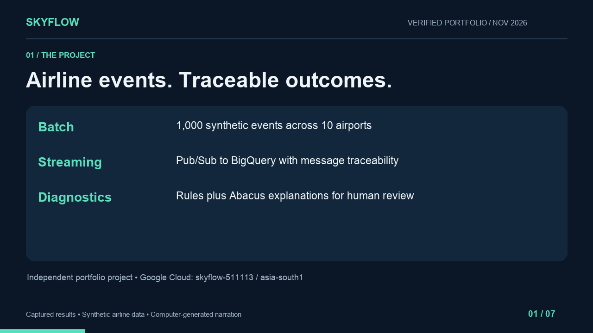
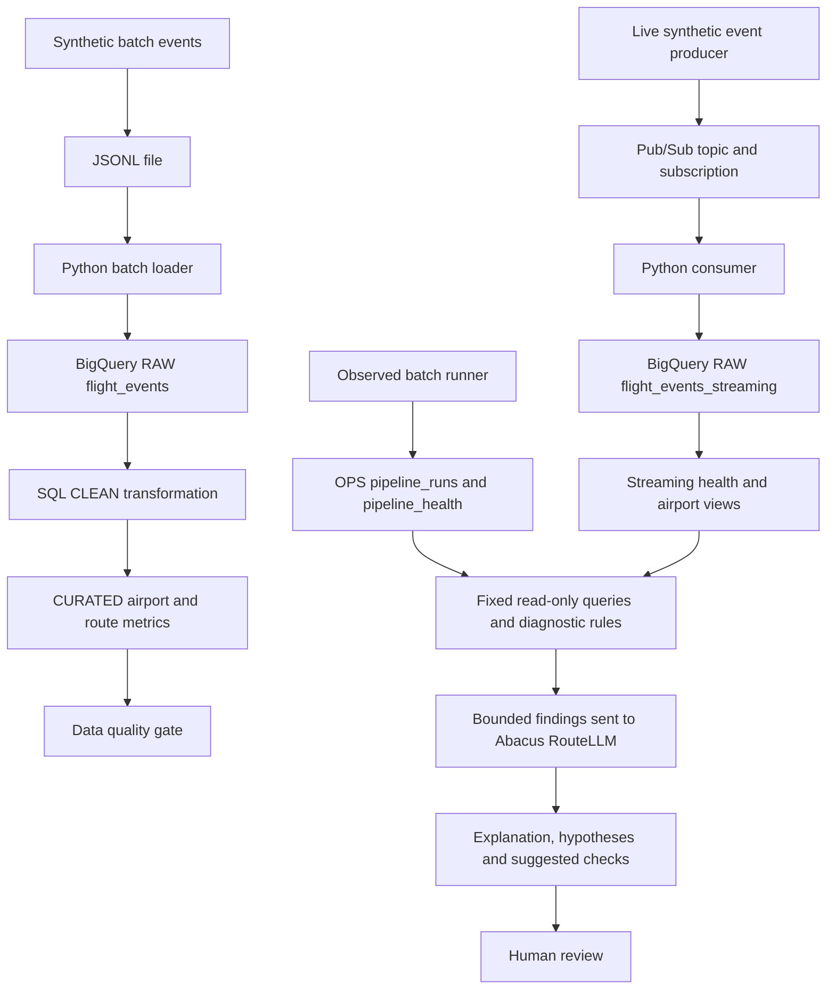

# SkyFlow .::. Airline DataOps Platform

[](https://github.com/rishijay-k/skyflow-airline-dataops/actions/workflows/ci.yml)

A portfolio project that processes synthetic airline events through batch and streaming pipelines on Google Cloud. Python handles generation, ingestion and operational logging; BigQuery provides RAW, CLEAN, CURATED and monitoring layers; Pub/Sub transports streaming events.

This is an independent learning project using synthetic data. It is not affiliated with any airline. GitHub Actions runs offline tests and Terraform validation on pushes and pull requests. Read-only AI-assisted diagnostics are verified with Abacus RouteLLM; the optional OpenAI adapter has not passed live acceptance. The completed scope is an on-demand portfolio; continuous production deployment is outside that scope.

## Finished portfolio

[Watch or download the narrated demo](https://github.com/rishijay-k/skyflow-airline-dataops/releases/download/v1.0.0/SkyFlow-demo.mp4) · [Acceptance evidence](docs/completion.md) · [Runbook](docs/runbook.md)



The video is an evidence walkthrough with computer-generated narration, not a live screen recording. The original portfolio scope is complete; documented production limitations remain.

## Architecture



The streaming table feeds operational views; it is not currently merged into the batch CLEAN/CURATED path.

## Implemented and verified

- Batch: generate 1,000 events, load RAW, normalize CLEAN statuses, build CURATED metrics, and enforce ten quality checks.
- Streaming: publish events to Pub/Sub, write them to BigQuery, and acknowledge messages after accepted writes.
- Observability: record batch outcomes, duration, row counts and error messages in BigQuery.
- Terraform: import four existing datasets plus the topic and subscription, with lifecycle deletion guards and a zero-change plan check.
- Diagnostics: deterministic evidence checks plus structured Abacus explanations, with no automatic remediation. Fresh live acceptance on November 15, 2026 verified the Abacus response alongside independent batch and streaming checks.
- Tests: 58 offline cases covering generation, quality gates, write failures, acknowledgements, batch logging and streaming exit status.

Fresh cloud acceptance on November 15, 2026 passed 10/10 batch quality checks and verified all 20 newly published streaming events by event and message ID. See [the acceptance report](docs/completion.md). Offline tests mock Google clients and do not prove current cloud health or execute the transformation SQL.

## Local setup and tests

Tested locally with Python 3.12.15. From the repository root:

```bash
python3 -m venv .venv
source .venv/bin/activate
python -m pip install -r requirements.txt
python -m pytest -q
```

Expected: `58 passed`. The dependency file records the development environment. GitHub Actions installs it on a fresh Linux runner and checks dependency compatibility before running tests.

## Existing Google Cloud environment

The Python, SQL and scripts currently reference project `skyflow-511113`; BigQuery uses `asia-south1`. Pub/Sub resource names are global. Using another project requires replacing the explicit project references throughout the source and SQL.

Cloud runs require the Google Cloud CLI, BigQuery CLI, Application Default Credentials, enabled BigQuery/Pub/Sub APIs and appropriate access to existing resources. For the current authorized project:

```bash
gcloud auth application-default login
gcloud auth application-default set-quota-project skyflow-511113
gcloud config set project skyflow-511113
```

These commands do not grant access to the project. A cloned repository alone does not provision a complete new environment.

From the project root, with `.venv` active:

```bash
# Rebuild batch data and enforce quality checks.
bash scripts/run_batch_pipeline.sh

# Run batch with an observability record.
python src/monitoring/run_observed_batch.py

# Publish events and check the live streaming path.
bash scripts/verify_streaming_pipeline.sh
```

The batch loader replaces the RAW batch table contents, and the SQL rebuilds CLEAN/CURATED tables. Streaming verification adds events to the streaming table. Cloud runs use billable Google Cloud services.

The observed batch runner requires the existing `skyflow_ops.pipeline_runs` table. Its creation SQL and health views are under `sql/ops/`.

## Terraform adoption

See [Terraform guide](infra/terraform/README.md). The current Mac already has six imported resources and a local state file. To inspect them:

```bash
cd infra/terraform
terraform init -input=false
terraform state list
bash verify-plan.sh
```

The acceptance result is `0 add, 0 change, 0 destroy`. Do not apply unexpected changes.

The existing dataset owner email is supplied by the ignored `terraform.tfvars`. On a deliberate fresh setup, copy `terraform.tfvars.example` to `terraform.tfvars` and enter the actual existing owner. Import into exactly one active state. Keep state securely backed up; it is not stored in Git.

## Repository layout

```text
src/generator/     Synthetic batch event generation
src/ingestion/     Batch BigQuery loader
src/streaming/     Pub/Sub producer and consumers
src/quality/       BigQuery quality gate
src/monitoring/    Batch observability wrapper
src/agent/         Evidence collection and optional AI explanations
sql/              RAW checks, CLEAN/CURATED transforms, OPS views
scripts/          Batch and streaming verification commands
infra/terraform/  Existing-resource adoption and plan validation
tests/            Offline automated tests
docs/             Verification and GitHub preparation notes
```

## Current limitations

- Raw batch status is generated independently of event type; CLEAN derives the normalized status while preserving the source value.
- Streaming validates required keys but does not fully validate every field value before writing.
- Message retries can produce duplicates; event IDs are used as insert IDs but there is no application-level exactly-once guarantee.
- A failed streaming message is NACKed without a configured dead-letter handling workflow in this code.
- `records_processed` records the final RAW row count, not an independently measured per-run count.
- Streaming verification checks exact published event and message IDs. Concurrent consumers or existing backlog can still cause a bounded verification run to fail; failure evidence is retained.
- Terraform adopts datasets and Pub/Sub resources; individual tables/views and IAM are not independently managed in this step.
- Continuous deployment and fresh-environment provisioning are outside the accepted portfolio scope. Live OpenAI verification is pending credentials; diagnostics do not perform autonomous remediation.

## Demo and portfolio

Follow the [demo script](docs/demo.md) for a short walkthrough and the [portfolio guide](docs/portfolio.md) for project wording. The finished 3-minute-47-second narrated video, transcript and evidence are available in the [v1.0.0 release](https://github.com/rishijay-k/skyflow-airline-dataops/releases/tag/v1.0.0). For architecture choices and verification boundaries, see [architecture](docs/architecture.md).

See [CI guide](docs/step28-ci.md) for automatic checks and their scope.

## Diagnostic workflow

See [Step 29 setup](docs/step29-diagnostics.md). Run `python src/agent/diagnose.py --demo` for a synthetic report, or omit `--demo` to read live BigQuery monitoring. Use `--ai --provider abacus` after configuring the private Abacus key to obtain explanations. OpenAI is an optional adapter.

## Abacus alternative

[Abacus setup](docs/step29-abacus.md) provides a separate provider and key setting. Use `python src/agent/diagnose.py --ai --provider abacus`. A fresh live-monitoring Abacus call passed on November 15, 2026; [captured output](docs/evidence/diagnostics.json) is included. OpenAI remains an optional, unverified live provider.
